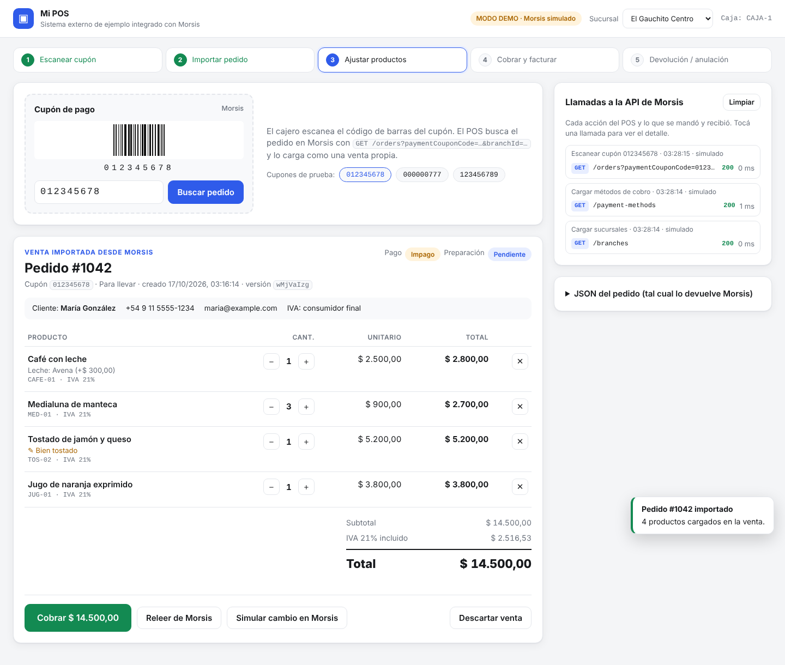
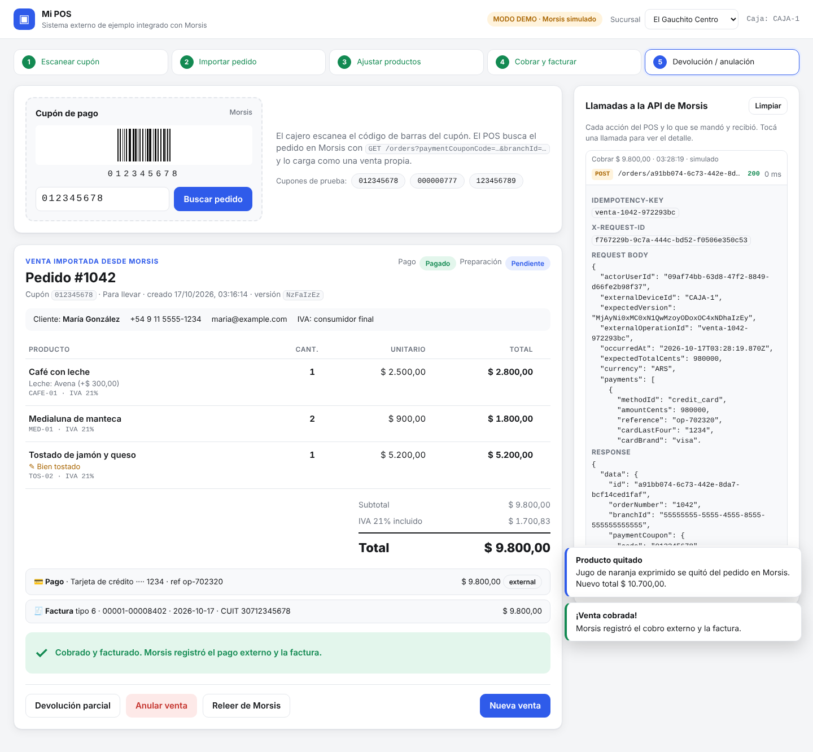
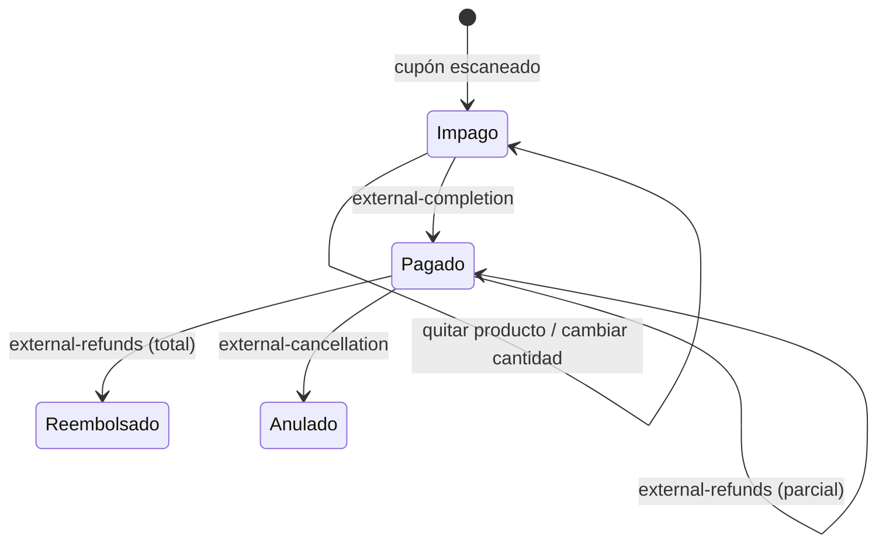

# POS de ejemplo integrado con Morsis

App mínima de referencia para integrar un **sistema de cobro externo (POS)** con la
[API pública de Morsis](https://api.morsis.com/docs). Muestra el flujo completo:

1. El cajero **escanea el cupón de pago** de Morsis.
2. El POS **busca el pedido** en Morsis y lo **carga como una venta propia**, con todos sus datos.
3. El cajero puede **quitar productos o cambiar cantidades**; cada cambio se aplica en Morsis.
4. El POS **cobra y factura con su propio sistema** y le informa a Morsis el pago y la factura.
5. Si hace falta, se registra una **devolución parcial** o la **anulación** de la venta.

La idea es que la uses como base: el código está separado en capas para que copies solo lo que te sirve.

> **¿Vas a integrar tu propio sistema?**
> - Programadores: [Guía de integración](docs/GUIA-INTEGRACION.md), paso a paso, sin depender de Node.js.
> - Asistentes de IA (LLM): [`AGENTS.md`](AGENTS.md), la misma guía escrita como especificación, con
>   invariantes y criterios de aceptación. También hay un [`llms.txt`](llms.txt) que indexa el repo.



---

## Probarlo en 1 minuto (sin API key)

Requisitos: Node.js 18 o superior. No hay dependencias que instalar.

```bash
npm start
# abrí http://localhost:3000
```

Sin `MORSIS_API_KEY` la app arranca en **modo demo**: usa un Morsis simulado en memoria con
pedidos de ejemplo. Tocá uno de los cupones de prueba (`012345678`, `000000777`, `123456789`) y
recorré el flujo. El panel de la derecha muestra **cada llamada a la API** con su request, su
response, el `Idempotency-Key` y el `X-Request-Id`.

En modo demo también está el botón **"Simular cambio en Morsis"**, que cambia la versión del pedido
por detrás para que veas cómo se maneja un `409 ORDER_VERSION_CONFLICT`.

```bash
npm test   # recorre el flujo completo contra el Morsis simulado
```

## Usarlo contra Morsis (modo real)

1. Pedile al comercio una **API key** de la API pública (Morsis → Integraciones → API pública) con
   los scopes `branches:read`, `orders:read`, `orders:write`, `orders:complete_external`,
   `orders:refund_external`, `payment_methods:read` y `team:read`, y acceso a la sucursal.
2. El **cajero** (`actorUserId`) es un usuario del equipo de Morsis. La app los trae con
   `GET /v1/team/members` y los muestra en **Cajero y caja** (botón "Cambiar" del encabezado),
   filtrados por la sucursal elegida. Se usa el `userId` del miembro, no su `id`. Tiene que tener
   `orders:edit` para cobrar y `orders:void` para devolver o anular. Si la key no tiene `team:read`,
   el mismo recuadro deja pegar el UUID a mano.
3. Copiá `.env.example` a `.env` y completalo:

   ```bash
   cp .env.example .env
   ```

   | Variable | Para qué |
   |---|---|
   | `MORSIS_API_KEY` | Clave de la API. **Nunca** la subas al repo ni la mandes al navegador. |
   | `MORSIS_BASE_URL` | `https://api-staging.morsis.com/v1` (pruebas) o `https://api.morsis.com/v1` |
   | `MORSIS_BRANCH_ID` | Sucursal donde se presentan los cupones (si no, se elige en pantalla) |
   | `MORSIS_ACTOR_USER_ID` | Cajero por defecto (opcional: se puede elegir en pantalla) |
   | `EXTERNAL_DEVICE_ID` | ID de tu caja / terminal |
   | `INVOICE_*` | CUIT, razón social, tipo de comprobante y punto de venta con los que factura tu sistema |

4. `npm start`. El encabezado muestra **MODO REAL** y la URL contra la que trabaja.

**Atajo para probar en el momento:** sin tocar el `.env`, arrancá con `npm start`, tocá
**Conectar con API key**, elegí staging o producción y pegá la key. La app
valida la key leyendo las sucursales, pasa a modo real y te pide elegir el cajero. La key va solo al servidor local y queda en
memoria hasta que lo cierres (o hasta tocar **Desconectar**). Por eso el servidor escucha solo en
`127.0.0.1`; cambialo con `HOST` únicamente si sabés lo que hacés.

> El archivo `.env` está en `.gitignore`. En un servidor, cargá estas variables como secretos del
> entorno en lugar de usar un archivo.

---

## Cómo está armado

```
src/
  morsis-client.js   Cliente HTTP de la API de Morsis. Independiente: copialo tal cual.
  integration.js     El flujo del POS paso a paso (cupón → venta → edición → cobro → reversas).
  mock-morsis.js     Morsis simulado en memoria, con la misma interfaz que el cliente real.
  config.js          Lectura de variables de entorno / .env.
server.js            Backend del POS de ejemplo: guarda la venta y expone /api/... a la UI.
public/              Interfaz web del cajero (HTML + CSS + JS, sin frameworks).
test/flow.test.js    El flujo completo como test.
```

- **`morsis-client.js`** es la pieza reutilizable: autenticación, `Idempotency-Key`, reintento ante
  `429` y errores normalizados (`MorsisApiError` con `status`, `code`, `details`, `requestId`).
- **`integration.js`** es la lógica que tu sistema tiene que implementar. Cada función está comentada.
- La **UI nunca habla con Morsis**: habla con el backend del POS, que es quien tiene la API key.

---

## El flujo, paso a paso

Todas las llamadas llevan `Authorization: Bearer <API key>`. Los montos son **enteros en centavos**
de ARS (`250000` = $ 2.500,00).

### 0. Elegir el cajero

```http
GET /v1/team/members?limit=100        # scope team:read; seguí meta.cursor mientras meta.hasMore
```

Cada miembro trae `userId`, `name`, `email`, `role`, `jobTitle` y `branchIds` (`null` = todas las
sucursales). Mostrá los que tienen acceso a la sucursal y guardá el `userId` elegido: es el
`actorUserId` de todos los comandos (ver `listCashiers` en `src/integration.js`).

### 1. Escanear el cupón y traer el pedido

```http
GET /v1/orders?paymentCouponCode=012345678&branchId=<uuid de la sucursal>
```

- El código del cupón es **texto**: conservá los ceros a la izquierda.
- Devuelve `{ data: [pedido], meta }` con cero o un pedido. Vacío = cupón inexistente en esa sucursal.
- Guardá en tu venta: `id` del pedido, `version` y el `lineItemId` de cada línea.

**Lista de cupones pendientes** (la columna "Cupones pendientes de cobro" de la app, ver `listPendingCoupons` en `src/integration.js`). Si el cajero no tiene el cupón a mano, tu sistema puede
listar los pedidos impagos de la sucursal y dejarlo elegir:

```http
GET /v1/orders?branchId=<uuid>&hasPaymentCoupon=true&paymentStatus=unpaid&preparationStatus=pending,confirmed,preparing,ready,completed,in_table&limit=20
```

- Sin `paymentCouponCode`, la respuesta trae **resúmenes** (`id`, `orderNumber`, `paymentCoupon`,
  `totalCents`, estados y fechas), del más nuevo al más viejo. No traen líneas ni `version`: al
  elegir uno, buscalo por su cupón (o con `GET /v1/orders/{id}`) como en el paso normal.
- Paginación: `meta.cursor` / `meta.hasMore`, con los mismos filtros; `meta.total` cuenta todos.
- `hasPaymentCoupon=true` también incluye pedidos ya cobrados o cancelados: por eso se combina con
  `paymentStatus=unpaid` y se excluye `cancelled`.

Lo que trae el pedido y cómo lo usa el POS (ver `orderToSale` en `src/integration.js`):

| Campo | Uso en el POS |
|---|---|
| `orderNumber`, `paymentCoupon.code` | Referencia visible de la venta |
| `customer` | Datos del cliente (nombre, CUIT/DNI, condición de IVA) para la factura |
| `items[]` | Líneas: `name`, `sku`, `quantity`, `priceCents`, `options[]`, `notes`, `taxRate`, **`totalCents`** (el total de la línea que manda Morsis es el que vale) |
| `subtotalCents`, `discountCents`, `deliveryFeeCents`, **`totalCents`** | Totales. `totalCents = subtotal − descuento + envío` |
| `taxBreakdown[]` | IVA incluido por alícuota (informativo; tu facturador aplica sus reglas) |
| `paymentStatus` | `unpaid` · `paid` · `refunded` |
| `preparationStatus` | `pending`, `confirmed`, `preparing`, `ready`, `completed`, `cancelled`, `in_table` |
| `payments[]`, `refunds[]`, `invoices[]` | Cobros, devoluciones y comprobantes ya registrados |
| `version` | Token opaco: mandalo sin tocar como `expectedVersion` en el próximo comando |

### 2. Ajustar productos

Solo se pueden editar pedidos **abiertos e impagos**. Cada comando lleva en el body
`actorUserId`, `externalDeviceId` y `expectedVersion`, y un header `Idempotency-Key` único.

```http
POST /v1/orders/{orderId}/item-removals          # quitar una línea
Idempotency-Key: 7c0e…

{ "actorUserId": "…", "externalDeviceId": "CAJA-1", "expectedVersion": "…", "lineItemId": "…" }
```

```http
PATCH /v1/orders/{orderId}/items/{lineItemId}    # cambiar cantidad (>= 1), opciones o notas
Idempotency-Key: 91af…

{ "actorUserId": "…", "externalDeviceId": "CAJA-1", "expectedVersion": "…", "quantity": 2 }
```

Cada respuesta trae el **pedido actualizado con una nueva `version`**: reemplazá tu copia local.
Combos, líneas ya enviadas a cocina y líneas con ajustes especiales no se editan por API.

### 3. Cobrar y facturar

Tu sistema cobra con sus medios y emite **su propia factura** (con su CUIT). Después se lo informa a Morsis:

```http
POST /v1/orders/{orderId}/external-completion
Idempotency-Key: venta-1042-213de7fa        ← igual a externalOperationId

{
  "actorUserId": "…", "externalDeviceId": "CAJA-1", "expectedVersion": "…",
  "externalOperationId": "venta-1042-213de7fa",
  "occurredAt": "2026-10-17T10:05:00-03:00",
  "expectedTotalCents": 980000,
  "currency": "ARS",
  "payments": [
    { "methodId": "credit_card", "amountCents": 980000, "reference": "op-912",
      "cardBrand": "visa", "cardLastFour": "1234", "installments": 3 }
  ],
  "invoice": {
    "issuerTaxId": "30712345678", "issuerName": "Empresa externa SA",
    "typeCode": 6, "pointOfSale": 1, "number": 8421,
    "issuedOn": "2026-10-17", "totalCents": 980000, "currency": "ARS"
  }
}
```

- **La suma de los pagos, el total de la factura y `expectedTotalCents` tienen que ser exactamente
  `totalCents`** del pedido; si no, `409 AMOUNT_MISMATCH`.
- `methodId` sale de `GET /v1/payment-methods`: `cash`, `debit_card`, `credit_card`,
  `bank_transfer`, `qr`, `payment_link`. Se pueden combinar varios pagos.
- Nunca mandes el número completo de la tarjeta ni el código de seguridad.
- Generá `externalOperationId` **una vez**, guardalo antes de llamar y reusalo en los reintentos:
  Morsis devuelve el mismo resultado sin duplicar el cobro.
- Resultado: `paymentStatus: "paid"`, el pago con `collectedBy: "external"` y la factura con `issuedBy: "external"`.



### 4. Devolución parcial

```http
POST /v1/orders/{orderId}/external-refunds
Idempotency-Key: devolucion-1042-1     ← igual a externalOperationId

{
  "actorUserId": "…", "externalDeviceId": "CAJA-1", "expectedVersion": "…",
  "externalOperationId": "devolucion-1042-1",
  "occurredAt": "2026-10-17T11:20:00-03:00",
  "reason": "Producto devuelto",
  "payments": [ { "paymentId": "<payments[].id>", "amountCents": 90000 } ],
  "items":    [ { "lineItemId": "…", "quantity": 1 } ],
  "creditNote": { "issuerTaxId": "30712345678", "issuerName": "…", "typeCode": 8,
                  "pointOfSale": 1, "number": 310, "issuedOn": "2026-10-17",
                  "totalCents": 90000, "currency": "ARS" }
}
```

- `items` es opcional (solo si se devolvió mercadería); sus importes salen de los precios de venta.
- La nota de crédito suma lo devuelto, la emite el mismo CUIT que facturó, con la letra de la
  factura (Factura B `6` → Nota de crédito B `8`) y con fecha no anterior a la factura.
- Cuando lo devuelto llega al total cobrado, el pedido pasa a `paymentStatus: "refunded"`.

### 5. Anulación total

```http
POST /v1/orders/{orderId}/external-cancellation
Idempotency-Key: anulacion-1042        ← igual a externalOperationId

{ "actorUserId": "…", "externalDeviceId": "CAJA-1", "expectedVersion": "…",
  "externalOperationId": "anulacion-1042", "occurredAt": "…",
  "reason": "El comprador desistió de la compra",
  "creditNote": { …, "totalCents": 980000 } }
```

Morsis cancela el pedido, devuelve el stock y revierte contabilidad y puntos. Si la venta ya tuvo
devoluciones, responde `409 ORDER_HAS_REFUNDS`: en ese caso devolvé el resto con el paso 4.

> **¿Y si el cliente se va antes de pagar?** No hay nada que informar: la API no anula pedidos
> impagos. El botón "Descartar venta" solo limpia el POS; el pedido sigue abierto en Morsis.

### Estados



---

## Reglas que conviene respetar

| Situación | Qué hacer |
|---|---|
| `409 ORDER_VERSION_CONFLICT` | El pedido cambió en Morsis. Releelo (`GET /v1/orders/{id}`), mostrale la diferencia al cajero y recién ahí reintentá. La demo lo hace automáticamente. |
| Cualquier otro `409` | No se aplicó nada. Releé el pedido antes de mandar otro comando. Códigos: `ORDER_NOT_EDITABLE`, `ORDER_BUSY`, `AMOUNT_MISMATCH`, `ORDER_HAS_REFUNDS`, `CREDIT_NOTE_MISMATCH`, `IDEMPOTENCY_CONFLICT`, entre otros. |
| Timeout o error de red | Reintentá con **el mismo** `Idempotency-Key` y el mismo body. |
| `429` | Esperá lo que diga `Retry-After` (el cliente lo hace una vez solo). |
| `401` / `403` | API key inválida, sin el scope necesario o sin acceso a la sucursal. |
| Reportar un problema | Guardá el `X-Request-Id` de la respuesta y pasáselo a Morsis. |
| Campos o estados nuevos | Ignorá los campos desconocidos y tratá los valores nuevos como "desconocido". |

Lo que Morsis **no** hace en este flujo: no cobra, no mueve plata y no emite comprobantes fiscales.
Todo eso lo hace tu sistema; Morsis solo lo registra.

## Referencias

- Guía para integrar otro sistema: [docs/GUIA-INTEGRACION.md](docs/GUIA-INTEGRACION.md) · para LLMs: [AGENTS.md](AGENTS.md)

- Documentación y consola interactiva: https://api.morsis.com/docs
- Especificación OpenAPI: https://api.morsis.com/v1/openapi.yaml
- Guía en Markdown: https://api.morsis.com/docs/agents.md
