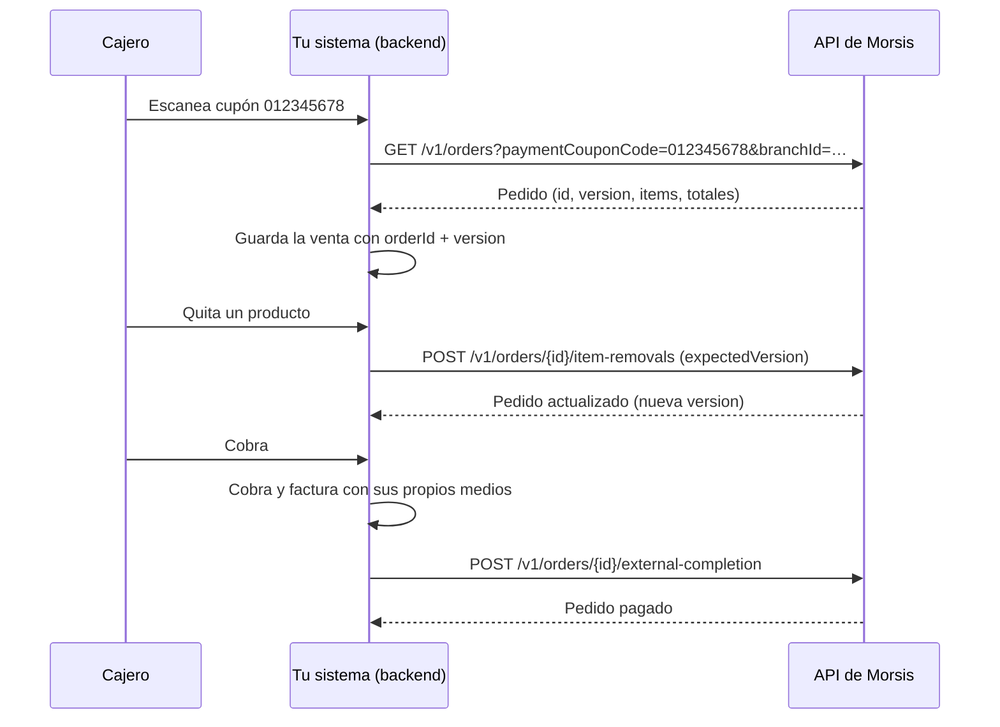
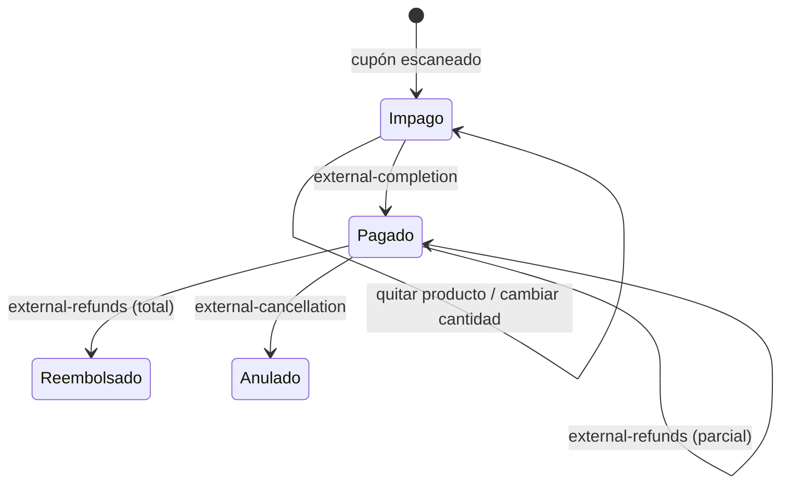

# Guía de integración: cobrar pedidos de Morsis desde tu sistema

Esta guía explica cómo integrar **tu propio sistema** (POS, caja, ERP o app de cobro) con Morsis
para cobrar pedidos a partir del **cupón de pago**. Es independiente del lenguaje: los ejemplos
usan HTTP y pseudocódigo, y al final hay un mapa al código de este demo (Node.js) por si querés ver
una implementación completa.

> ¿Vas a pedirle a un asistente de IA que escriba la integración? Pasale [`AGENTS.md`](../AGENTS.md):
> tiene las mismas reglas escritas como especificación para un LLM.

---

## 1. Qué vas a construir

El cliente arma su pedido en Morsis (salón, mostrador, web) y recibe un **cupón de pago**: un
código de barras numérico. En tu caja:

1. El cajero escanea el cupón.
2. Tu sistema trae el pedido de Morsis y lo carga como una venta propia.
3. Si hace falta, el cajero quita productos o cambia cantidades; cada cambio se aplica en Morsis.
4. Tu sistema cobra con sus medios y emite **su propia factura**.
5. Tu sistema le informa a Morsis el cobro y la factura. Morsis cierra el pedido.
6. Más adelante, si hay una devolución o una anulación, tu sistema la informa con su nota de crédito.

Morsis **no cobra, no mueve plata y no emite comprobantes** en este flujo: solo registra lo que
hizo tu sistema.



## 2. Antes de empezar

### Credenciales

El comercio crea una **API key** en Morsis (Integraciones → API pública). Pedila con estos scopes:

| Scope | Para qué |
|---|---|
| `branches:read` | Listar sucursales |
| `team:read` | Listar cajeros (usuarios del equipo) |
| `orders:read` | Buscar y leer pedidos |
| `orders:write` | Quitar productos y cambiar cantidades |
| `orders:complete_external` | Informar el cobro y la factura |
| `orders:refund_external` | Informar devoluciones y anulaciones |
| `payment_methods:read` | Listar medios de cobro |

La key tiene que tener acceso a las sucursales donde vas a cobrar.

**La API key vive solo en tu backend.** Nunca la pongas en una app de navegador, en una app móvil
ni en el código del repositorio. Guardala como secreto (variable de entorno, gestor de secretos).

### Entornos

| Entorno | URL base |
|---|---|
| Staging (pruebas) | `https://api-staging.morsis.com/v1` |
| Producción | `https://api.morsis.com/v1` |

Todas las llamadas llevan `Authorization: Bearer <API key>`. La especificación completa está en
[`/v1/openapi.yaml`](https://api.morsis.com/v1/openapi.yaml) y la consola interactiva en
[api.morsis.com/docs](https://api.morsis.com/docs).

### Configuración de cada caja

| Dato | De dónde sale |
|---|---|
| `branchId` | `GET /v1/branches` → `data[].id`. La sucursal donde está la caja. |
| `actorUserId` | `GET /v1/team/members` → `data[].userId` del cajero (ver paso 0). |
| `externalDeviceId` | Lo definís vos: el ID de tu caja o terminal (ej. `CAJA-3`). |
| Datos fiscales | CUIT, razón social, punto de venta y tipo de comprobante con los que factura tu sistema. |

## 3. Arquitectura recomendada

```
[Pantalla de caja] → [Tu backend] → [API de Morsis]
                         │
                         └── tu base de datos (venta + referencias a Morsis)
```

- La pantalla habla solo con tu backend. El backend es el único que conoce la API key.
- Aislá las llamadas a Morsis en un **cliente** (un módulo) con autenticación, `Idempotency-Key`,
  manejo de `429` y errores normalizados. En este demo es `src/morsis-client.js`.
- Guardá en tu base, junto a tu venta, las referencias a Morsis:

| Campo | Tipo | Para qué |
|---|---|---|
| `morsis_order_id` | uuid | Identifica el pedido en todas las llamadas |
| `morsis_coupon_code` | texto | El código escaneado, **como texto** (conserva ceros a la izquierda) |
| `morsis_version` | texto | Última `version` recibida. Se manda como `expectedVersion` |
| `morsis_line_item_id` (por línea) | uuid | Para editar o devolver esa línea |
| `morsis_payment_id` (por pago) | uuid | `payments[].id` que devuelve Morsis al cobrar; se usa en devoluciones |
| `external_operation_id` | texto | ID de la operación de cobro/devolución/anulación (ver idempotencia) |
| `morsis_sync_status` | enum | `pendiente`, `informado`, `error` (para reintentos) |

## 4. El flujo paso a paso

Montos: **enteros en centavos de ARS** (`250000` = $ 2.500,00). Moneda: siempre `ARS`.

### Paso 0. Elegir el cajero

```http
GET /v1/team/members?limit=100
```

Devuelve `{ data: [miembro], meta: { cursor, hasMore } }`. Seguí pidiendo con `cursor=meta.cursor`
mientras `meta.hasMore` sea `true`. Cada miembro trae `id`, `userId`, `name`, `email`, `role`,
`jobTitle` y `branchIds`.

- Mostrá los miembros con acceso a la sucursal: `branchIds === null` (todas) o que la incluya.
- Guardá el **`userId`** del elegido. Ese es el `actorUserId`. El campo `id` es la membresía y
  **no** sirve como `actorUserId`.
- El cajero tiene que tener permiso para editar pedidos (`orders:edit`) y, para devoluciones y
  anulaciones, para anularlos (`orders:void`).

### Paso 1. Escanear el cupón y traer el pedido

```http
GET /v1/orders?paymentCouponCode=012345678&branchId=55555555-5555-4555-8555-555555555555
```

- Respuesta: `{ data: [pedido], meta }` con **cero o un** pedido. `data` vacío = el cupón no existe
  en esa sucursal.
- El código es **texto**: no lo conviertas a número.
- Si el pedido ya tiene `paymentStatus` distinto de `unpaid`, ya fue cobrado: mostralo, pero no
  permitas editarlo ni cobrarlo de nuevo.

Para releer un pedido que ya tenés: `GET /v1/orders/{orderId}`.

**Opcional: elegir el cupón de una lista.** Si el cajero no tiene el cupón a mano, tu sistema puede
listar los pedidos impagos de la sucursal y dejarlo elegir:

```http
GET /v1/orders?branchId=<uuid>&hasPaymentCoupon=true&paymentStatus=unpaid&preparationStatus=pending,confirmed,preparing,ready,completed,in_table&limit=20
```

- Sin `paymentCouponCode`, la respuesta trae **resúmenes** (`id`, `orderNumber`, `paymentCoupon`,
  `totalCents`, estados y fechas), del más nuevo al más viejo. No traen líneas ni `version`: al
  elegir uno, buscalo por su cupón (o con `GET /v1/orders/{id}`) como en el paso normal.
- Paginación: `meta.cursor` / `meta.hasMore`, con los mismos filtros; `meta.total` cuenta todos.
- `hasPaymentCoupon=true` también incluye pedidos ya cobrados o cancelados: por eso se combina con
  `paymentStatus=unpaid` y se excluye `cancelled`.

### Paso 2. Cargar el pedido como venta propia

Campos del pedido que te importan:

| Campo | Uso |
|---|---|
| `id`, `version` | Guardalos: son la referencia para todo lo demás |
| `orderNumber`, `paymentCoupon.code` | Referencia visible |
| `customer` | Nombre, `taxId`, `ivaCondition`, etc. para la factura (puede ser `null`) |
| `items[]` | `lineItemId`, `name`, `sku`, `quantity`, `priceCents`, `options[]`, `notes`, `taxRate`, **`totalCents`** |
| `subtotalCents`, `discountCents`, `deliveryFeeCents`, **`totalCents`** | `totalCents = subtotal − descuento + envío` |
| `taxBreakdown[]` | IVA incluido por alícuota (informativo) |
| `paymentStatus` | `unpaid`, `paid`, `refunded` |
| `preparationStatus` | `pending`, `confirmed`, `preparing`, `ready`, `completed`, `cancelled`, `in_table` |

Reglas:
- **Usá los importes de Morsis tal cual.** `items[].totalCents` es el total de la línea (incluye
  opciones y ajustes) y `totalCents` es lo que hay que cobrar. No recalcules precios.
- Ignorá campos que no conozcas y tratá estados nuevos como "desconocido": la API agrega cosas.
- Una línea con `lineItemId: null` es de solo lectura.

### Paso 3. Quitar productos o cambiar cantidades

Solo con el pedido **abierto e impago**. Todos los comandos llevan este contexto en el body:

```json
{ "actorUserId": "<userId del cajero>", "externalDeviceId": "CAJA-3", "expectedVersion": "<version>" }
```

y un header `Idempotency-Key` **nuevo por cada acción del cajero** (por ejemplo un UUID).

Quitar una línea:

```http
POST /v1/orders/{orderId}/item-removals
Idempotency-Key: 7c0e1f2a-…

{ "actorUserId": "…", "externalDeviceId": "CAJA-3", "expectedVersion": "…", "lineItemId": "…" }
```

Cambiar cantidad (mínimo 1; para dejarla en 0 quitá la línea):

```http
PATCH /v1/orders/{orderId}/items/{lineItemId}
Idempotency-Key: 91af…

{ "actorUserId": "…", "externalDeviceId": "CAJA-3", "expectedVersion": "…", "quantity": 2 }
```

- La respuesta es el **pedido completo actualizado**: reemplazá tu copia y guardá la nueva `version`.
- No mandes dos cambios en paralelo sobre el mismo pedido: esperá la respuesta del anterior
  (el segundo llevaría una `version` vieja). Mostrale al cajero que se está aplicando.
- Combos, líneas ya enviadas a cocina y líneas con ajustes especiales no se editan por API
  (`409`). Mostrá el motivo y dejá la línea como está.

### Paso 4. Cobrar, facturar e informar a Morsis

1. Cobrá en tu sistema el `totalCents` del pedido (uno o varios medios).
2. Emití tu factura por ese mismo total.
3. Generá un `externalOperationId` (ej. `venta-1042-8f3a`), **guardalo en tu base** y recién después llamá:

```http
POST /v1/orders/{orderId}/external-completion
Idempotency-Key: venta-1042-8f3a          ← exactamente igual a externalOperationId

{
  "actorUserId": "…", "externalDeviceId": "CAJA-3", "expectedVersion": "…",
  "externalOperationId": "venta-1042-8f3a",
  "occurredAt": "2026-10-17T10:05:00-03:00",
  "expectedTotalCents": 980000,
  "currency": "ARS",
  "payments": [
    { "methodId": "credit_card", "amountCents": 980000, "reference": "lote-12-cupon-345",
      "cardBrand": "visa", "cardLastFour": "1234", "installments": 3 }
  ],
  "invoice": {
    "issuerTaxId": "30712345678", "issuerName": "Empresa SA",
    "typeCode": 6, "pointOfSale": 1, "number": 8421,
    "issuedOn": "2026-10-17", "totalCents": 980000, "currency": "ARS"
  }
}
```

- **Suma de `payments[].amountCents` = `invoice.totalCents` = `expectedTotalCents` = `totalCents`
  del pedido.** Si no coinciden, `409 AMOUNT_MISMATCH`.
- `methodId`: uno de `GET /v1/payment-methods` (`cash`, `debit_card`, `credit_card`,
  `bank_transfer`, `qr`, `payment_link`). `reference` es obligatorio.
- Tarjetas: solo `cardBrand`, `cardLastFour` (4 dígitos) y `installments` (solo crédito).
  **Nunca** el número completo ni el código de seguridad.
- `occurredAt`: cuándo cobraste (hasta 5 minutos en el futuro). `issuedOn`: fecha de la factura
  (`YYYY-MM-DD`). Opcionales de la factura: `authorizationCode` (CAE de 14 dígitos),
  `authorizationExpiresOn`, `recipientTaxId`, `recipientName`, `documentUrl` (https).
- Respuesta: el pedido con `paymentStatus: "paid"`. **Guardá `payments[].id`**: lo vas a necesitar
  para devoluciones.

> **Lo más importante del paso 4.** Si la llamada falla por timeout o red, la plata ya está
> cobrada: **reintentá con el mismo `externalOperationId`, el mismo `Idempotency-Key` y el mismo
> body**. Morsis devuelve el resultado original sin duplicar nada. Si generás un ID nuevo, vas a
> intentar registrar el cobro dos veces. Dejá la venta en `pendiente de informar` y reintentá
> (con backoff) hasta tener respuesta.

### Paso 5. Devoluciones y anulaciones

Las dos requieren la **misma API key que informó el cobro** y un cajero con `orders:void`.

**Devolución parcial o total:**

```http
POST /v1/orders/{orderId}/external-refunds
Idempotency-Key: devolucion-1042-1        ← igual a externalOperationId

{
  "actorUserId": "…", "externalDeviceId": "CAJA-3", "expectedVersion": "…",
  "externalOperationId": "devolucion-1042-1",
  "occurredAt": "2026-10-17T11:20:00-03:00",
  "reason": "Producto devuelto",
  "payments": [ { "paymentId": "<payments[].id>", "amountCents": 90000 } ],
  "items":    [ { "lineItemId": "…", "quantity": 1 } ],
  "creditNote": { "issuerTaxId": "30712345678", "issuerName": "Empresa SA", "typeCode": 8,
                  "pointOfSale": 1, "number": 310, "issuedOn": "2026-10-17",
                  "totalCents": 90000, "currency": "ARS" }
}
```

- `items` solo si se devolvió mercadería; sus importes salen de los precios de venta.
- Cada `amountCents` no puede superar lo que queda sin devolver de ese pago.
- La nota de crédito: total = suma devuelta, **mismo CUIT** que la factura, **misma letra**
  (Factura A 1 → NC A 3, B 6 → 8, C 11 → 13) y fecha igual o posterior a la factura.
- Cuando lo devuelto llega al total, el pedido pasa a `paymentStatus: "refunded"`.

**Anulación total** (solo si no hubo devoluciones; si las hubo, devolvé el resto):

```http
POST /v1/orders/{orderId}/external-cancellation
Idempotency-Key: anulacion-1042           ← igual a externalOperationId

{ "actorUserId": "…", "externalDeviceId": "CAJA-3", "expectedVersion": "…",
  "externalOperationId": "anulacion-1042", "occurredAt": "…",
  "reason": "El comprador desistió de la compra",
  "creditNote": { …, "totalCents": 980000 } }
```

Morsis cancela el pedido, devuelve el stock y revierte contabilidad y puntos.

**¿Y si el cliente se va antes de pagar?** No hay que informar nada: la API no anula pedidos
impagos. Descartá la venta en tu sistema; el pedido sigue abierto en Morsis.

### Estados del pedido desde tu sistema



## 5. Reglas que aplican a todo

### Versiones (`expectedVersion`)

Cada pedido trae un `version` opaco (no lo parsees ni lo modifiques). Mandalo como
`expectedVersion` en el siguiente comando y reemplazalo por el que venga en la respuesta.
Si Morsis responde `409 ORDER_VERSION_CONFLICT`, el pedido cambió en Morsis (alguien lo editó):
**releelo con `GET /v1/orders/{id}`, mostrale al cajero lo que cambió y recién ahí reintentá**.
No reintentes automáticamente a ciegas: el total pudo haber cambiado.

### Idempotencia (`Idempotency-Key`)

| Operación | Qué key usar | Cuánto dura |
|---|---|---|
| Quitar / editar línea | Una nueva por cada acción del cajero; la misma si reintentás esa acción | 24 horas |
| Cobro, devolución, anulación | **Igual a `externalOperationId`**, guardado antes de llamar | No vence |

Misma key con otro body = `409 IDEMPOTENCY_CONFLICT`. Máximo 120 caracteres.

### Errores

Las respuestas de error tienen la forma `{ "error": { "code", "message", "details"? } }` y el
header `X-Request-Id`. Decidí por `error.code` y, si no lo conocés, por el status HTTP.

| Status / código | Qué hacer |
|---|---|
| `400 VALIDATION_ERROR` | Un dato está mal. `details[].path` dice cuál. No reintentes igual. |
| `401` | API key inválida, vencida o revocada. |
| `403` | Falta un scope, un módulo o acceso a la sucursal. |
| `404` | Pedido, línea o pago inexistente o fuera del alcance de la key. |
| `409 ORDER_VERSION_CONFLICT` | Releé el pedido y mostralo antes de reintentar. |
| `409 ORDER_NOT_EDITABLE` | El pedido ya no está abierto e impago. |
| `409 ORDER_BUSY` | Morsis está procesando otra operación: reintentá en unos segundos. |
| `409 AMOUNT_MISMATCH` | Pagos, factura y total no coinciden con el total actual. Releé el pedido. |
| `409 ORDER_HAS_REFUNDS` | No se puede anular: devolvé el resto con `external-refunds`. |
| `409 CREDIT_NOTE_MISMATCH` | La nota de crédito no coincide (total, CUIT, letra o fecha). |
| `409 IDEMPOTENCY_CONFLICT` | Reusaste una key con otro body. Revisá la operación original. |
| `409` (otros) | No se aplicó nada. Releé el pedido antes de mandar otro comando. |
| `429` | Esperá lo que diga `Retry-After` y reintentá. |
| `5xx`, timeout | Reintentá con la **misma** key y el mismo body. |

Guardá siempre el `X-Request-Id` de los errores: es lo que pide Morsis para investigar.

## 6. Casos que conviene probar en staging

- [ ] Cupón inexistente y cupón de otra sucursal.
- [ ] Cupón con ceros a la izquierda (`000000777`).
- [ ] Pedido que ya está pagado.
- [ ] Quitar todas las líneas menos una; bajar una cantidad a 0.
- [ ] Editar el pedido en Morsis mientras está abierto en tu caja → `ORDER_VERSION_CONFLICT`.
- [ ] Cobro con un medio, con dos medios y con tarjeta de crédito en cuotas.
- [ ] Cortar la red durante el cobro y reintentar: un solo pago en Morsis.
- [ ] Devolución parcial con y sin productos; devolución del resto; anulación.
- [ ] Anular después de una devolución → `ORDER_HAS_REFUNDS`.
- [ ] API key sin `team:read`: el sistema sigue funcionando con el cajero cargado a mano.

## 7. Checklist antes de producción

- [ ] La API key está solo en el backend, como secreto, y es la de producción.
- [ ] Cada caja tiene `branchId`, `externalDeviceId` y un cajero (`actorUserId`) configurados.
- [ ] `externalOperationId` se guarda **antes** de informar el cobro y se reusa en reintentos.
- [ ] Hay una cola o tarea que reintenta los cobros `pendientes de informar`.
- [ ] Los errores se registran con su `X-Request-Id`.
- [ ] Las notas de crédito usan el mismo CUIT y la misma letra que la factura.

## 8. Dónde está cada cosa en este demo

| Tema | Archivo |
|---|---|
| Cliente HTTP reutilizable (auth, idempotencia, 429, errores) | [`src/morsis-client.js`](../src/morsis-client.js) |
| El flujo de negocio paso a paso | [`src/integration.js`](../src/integration.js) |
| Cómo el backend guarda la venta y maneja los `409` | [`server.js`](../server.js) (`withOrder`) |
| Morsis simulado con las mismas reglas | [`src/mock-morsis.js`](../src/mock-morsis.js) |
| El flujo completo como test | [`test/flow.test.js`](../test/flow.test.js) |
